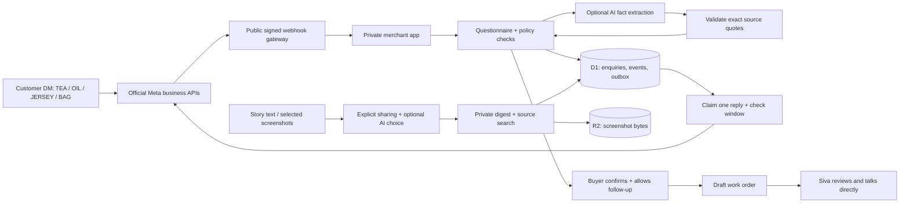

# Shop Concierge

A private shop desk for Siva: turn WhatsApp and Instagram product enquiries into **buyer-confirmed draft work orders**, and keep a digest of the Stories/status updates he intentionally shares.

Built for **Nilgiris tea, eucalyptus oil, running jerseys and custom bags**, with India and US enquiry flows.

**Current version:** a working, persistent sample workspace plus official API adapters. No Meta business accounts or OpenAI provider are connected. Sample enquiries are fictional. Prices, stock, product origin/claims and shipping are unapproved until the merchant enters and approves them. This app never confirms payments or places an order.

## Try it

The merchant’s [private app](https://siva-shop-concierge.siva-babu.chatgpt.site) requires owner access. Public source does not grant access to customer data.

1. Open **Enquiry desk**. Confirm the sample jersey enquiry and see its readiness change.
2. Test another product, answer its missing questions, or ask for a person.
3. Use **Stories digest** to add text or a screenshot. Try the fictional samples without an API key.
4. Enter real facts in **Catalog**, then approve each product.
5. Inspect **Trust & activity** for source evidence, guardrail events and the evaluation snapshot.

## What works

| Journey             | Behavior                                                                                                     |
| ------------------- | ------------------------------------------------------------------------------------------------------------ |
| Product intake      | Product-specific questions, India/US market, delivery location, deadline and payment preference              |
| Lead review         | Browsing → Needs details → Ready for discussion; human handoff and opt-out remain available                  |
| Draft work order    | Buyer confirmation and follow-up permission required; downloadable text with source evidence                 |
| Stories digest      | Intentionally shared text and PNG/JPEG/WebP screenshots; persistent private storage, source search, deletion |
| Optional AI         | Responses API extracts explicit facts with exact source quotes; optional shared text/image summary           |
| Catalog grounding   | Customer replies use only approved catalog facts; prices remain quote-required by default                    |
| Business connectors | Signed Meta webhooks, account filtering, replay protection, durable outbox, controlled official sends        |
| Owner alerts        | Review queue, open-tab refresh and optional browser notifications while the desk is open                     |

No “genuine buyer” or sincerity score is used. Readiness means the enquiry contains the required information, passes consistency checks, and the buyer agrees to follow-up. Incomplete enquiries remain visible rather than being silently discarded.

## Local setup

Requires Node.js **22.16+**, npm and a loopback browser.

```sh
npm ci
npm test
npm run typecheck
npm run build
node --import ./scripts/sites-env.mjs ./node_modules/wrangler/bin/wrangler.js d1 execute DB --local --config dist/server/wrangler.json --persist-to .wrangler/state --file drizzle/0000_crazy_ulik.sql
node --import ./scripts/sites-env.mjs ./node_modules/wrangler/bin/wrangler.js d1 execute DB --local --config dist/server/wrangler.json --persist-to .wrangler/state --file drizzle/0001_steady_gressill.sql
npm run dev
```

Apply each migration **once, in filename order**. Visit the Local URL printed by the server and click **Sign in to your desk**. Portable development simulates the user `local_seedy`; production builds do not include that mock sign-in.

Copy `.env.example` to `.env` only if enabling optional providers. Never commit the populated file. To host your own copy, register your own Site and replace the deployment identity in `.openai/hosting.json`; preserve logical `DB` and `BUCKET` bindings. This repository’s deployment ID belongs to the original merchant’s private app.

## Architecture



## Technologies and where they are used

| Technology                         | Use                                                                                               |
| ---------------------------------- | ------------------------------------------------------------------------------------------------- |
| Codex                              | Product design, implementation, threat cases, tests, deployment and documentation                 |
| React + TypeScript + Vinext/Vite   | Responsive merchant desk and server routes                                                        |
| Cloudflare Workers                 | Request handling, validation and Meta adapters                                                    |
| Cloudflare D1 + Drizzle migrations | Owner-scoped durable enquiries, catalog, digest metadata, outbox and rate limits                  |
| Cloudflare R2                      | Private screenshots, fetched only after owner authorization                                       |
| ChatGPT/Sites sign-in              | Hosted access boundary and stable per-Site owner identity                                         |
| OpenAI Responses API, optional     | Schema-constrained extraction, text summaries and image reading; source-checked and consent-gated |
| Meta WhatsApp Cloud API, optional  | Business inbound webhooks and replies within an active customer-service window                    |
| Instagram Messaging API, optional  | Professional-account DMs and replies to customer-initiated conversations                          |
| Node test runner + GitHub Actions  | Regression scenarios, type checking and Worker build                                              |
| WebMCP                             | Read-only enquiry queue tool using the same visible state                                         |

The default demo uses **local rules and extractive text summaries**, not a hidden live LLM. AI summaries and normalized extraction require a configured model, provider key and explicit permission. API billing is separate from a ChatGPT subscription.

## Security and ethical boundaries

- Private app plus server-side identity checks; queries always include the owner key.
- A small public gateway validates Meta HMAC signatures before forwarding to the private app. It does not expose the merchant desk.
- Approved catalog facts only; no invented prices, guaranteed delivery, verified stock or medical claims.
- No card numbers, OTPs, passwords or payment verification. Obvious sensitive number/credential patterns are removed before persistence and provider calls; this is a limited pattern filter, not complete PII anonymization.
- AI facts require valid field names and exact supporting source quotes. Rules own consent, confirmation and readiness. Generated prose is never used to place orders or verify payment.
- Customer messages and Story content are untrusted input, not system instructions.
- Screenshot MIME/signature checks and bounded body reads; no arbitrary remote URL fetching.
- Replays are deduplicated; lead writes use optimistic revisions. Outbox sends are claimed atomically, and uncertain delivery needs human review rather than blind retries.
- Demo conversations are blocked from external sends even if credentials are later added.
- Event logs contain labels and operational details, not message bodies. Customer text is stored only in authorized conversation/digest records.
- Owner actions and uploads are rate limited; optional AI calls have a bounded per-minute quota.

See [the threat model](docs/security.md), [live setup](docs/live-setup.md) and [evaluation snapshot](docs/evaluation-results.json).

## Limits and next steps

Ordinary business APIs do **not** expose Siva’s entire personal WhatsApp inbox or the Stories feed he browses. This version deliberately accepts shared text/screenshots instead. Video Stories need selected screenshots or a transcript; there is no automatic video transcription yet. Search is lexical matching over saved sources, not a conversational model claiming to have watched a private feed.

Live activation requires business/professional accounts, a Meta app, permissions/review appropriate to its use, merchant-approved product facts, credentials and a public HTTPS gateway. Both countries are supported as enquiry markets; this is not confirmation of cross-border fulfillment or payment acceptance.

Free-form sends are limited conservatively to a customer-initiated **24-hour** window. Outside it, the app blocks sends. Approved WhatsApp templates, checkout/payment processing and a full catalog/stock system are future work. Browser alerts currently work while the desk is open; there is no background push service or digest schedule configured.

## Official references

- [Meta’s official WhatsApp collections](https://www.postman.com/meta/whatsapp-business-platform/overview)
- [Instagram Send API](https://www.postman.com/meta/instagram/folder/uxudqu0/send-api)
- [WhatsApp Business Messaging Policy](https://whatsappbusiness.com/policy/)
- [OpenAI structured outputs](https://developers.openai.com/api/docs/guides/structured-outputs)
- [OpenAI images and vision](https://developers.openai.com/api/docs/guides/images-vision)

## License

Original app code: MIT. Bundled starter and dependency notices are retained; see `build/sites-vite-plugin.LICENSE`.
